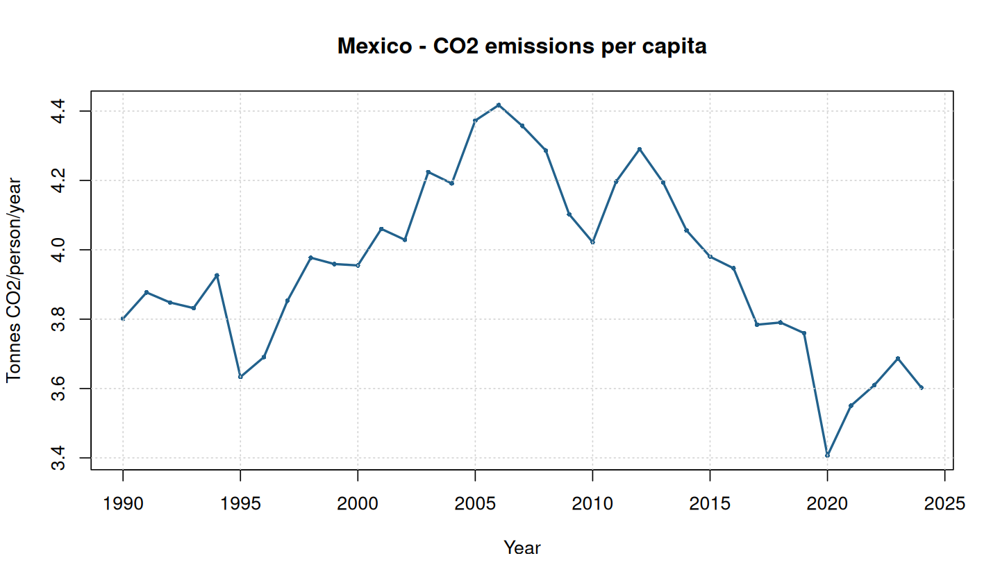
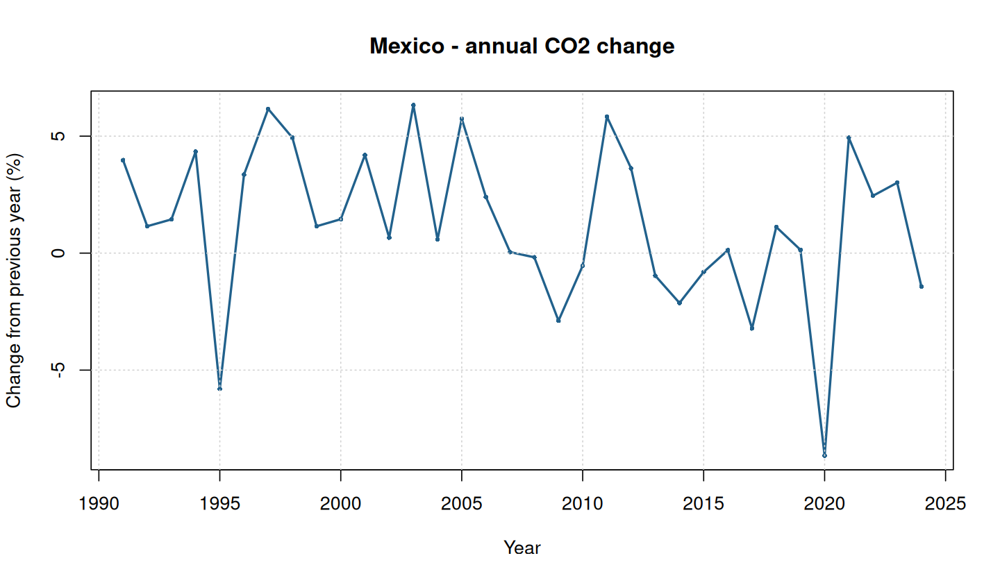

# CO₂ Emissions Analysis: Mexico (MEX)

**Student:** Mikylla Jamin

**GitHub Username:** jaminmikylla24-prog  

**Country:** Mexico  

**ISO-3 Code:** MEX  

**Study Period:** 1990–2024

## 1. Research Question

How have annual CO₂ emissions and CO₂ emissions per capita changed in Mexico from 1990 to 2024?

## 2. Data Source

This project uses data from Our World in Data (OWID), specifically the CO₂ and Greenhouse Gas Emissions dataset.

Dataset: https://github.com/owid/co2-data

The selected variables are:

- Year

- Annual CO₂ emissions

- CO₂ emissions per capita

Annual CO₂ emissions are measured in million tonnes per year, while per-capita emissions are measured in tonnes per person per year.

## 3. Software and Tools

The following tools were used:

- R

- RStudio

- Git

- GitHub

## 4. Methodology

The analysis was conducted using RStudio. The complete OWID dataset was downloaded and filtered to include only Mexico using its ISO-3 country code, MEX.

The selected data covered the period 1990–2024. The R script generated a country-specific CSV file, three graphs, summary statistics, and yearly percentage changes.

To reproduce the analysis, open the project in RStudio and run:

`source("scripts/analyze_co2.R")`

## 5. Project Files and Outputs

- `data/MEX_co2.csv` – Mexico's CO₂ emissions dataset.

- `scripts/analyze_co2.R` – R script used for the analysis.

- `figures/MEX_annual_co2.png` – Annual CO₂ emissions graph.

- `figures/MEX_per_capita.png` – CO₂ emissions per capita graph.

- `figures/MEX_annual_change.png` – Annual percentage change graph.

- `results/MEX_summary.csv` – Summary statistics.

- `results/MEX_yearly_changes.csv` – Yearly percentage changes.

- `results/session_info.txt` – R session information.

## 6. Graphical Results

### Annual CO₂ Emissions in Mexico

### CO₂ Emissions Per Capita

### Annual Percentage Change in CO₂ Emissions

## 7. Environmental Interpretation

Mexico's annual CO₂ emissions generally increased between 1990 and 2024. In 1990, emissions were approximately 314.82 million tonnes, compared with 471.45 million tonnes in 2024. This represents an overall increase of 49.75%. Emissions reached their highest level in 2012, at approximately 501.20 million tonnes. A sustained upward trend can be observed from 1990 to 2007, although emissions temporarily decreased in 1995.

An unusual year was 2020, when annual emissions decreased by approximately 8.66%, from 472.84 million tonnes in 2019 to 431.90 million tonnes. One possible explanation is the COVID-19 pandemic, which disrupted transportation and economic activities around the world. The International Energy Agency reported that pandemic restrictions reduced global energy demand and CO₂ emissions in 2020. However, this global explanation does not prove the exact cause of Mexico's decrease.

Total emissions and per-capita emissions provide different information. Total emissions represent Mexico's overall CO₂ contribution, while per-capita emissions represent the average emissions per person. Mexico's per-capita emissions reached approximately 4.42 tonnes in 2006 and declined to 3.60 tonnes in 2024.

These findings are environmentally important because CO₂ contributes to climate change, which can affect ecosystems, biodiversity, and natural resources. However, this analysis has limitations because national emissions data do not show differences among regions or individual industries. It also focuses on CO₂ rather than all greenhouse gases. Therefore, the results identify emission patterns but cannot establish their exact causes.

## 8. Limitations

The dataset focuses on territorial CO₂ emissions from fossil fuels and industrial processes. It does not represent all greenhouse gases or include land-use change emissions. Missing values were not treated as zero. National-level data may also hide differences between regions and industries within Mexico. Observed patterns do not establish causation.

## 9. References

- Our World in Data. CO₂ and Greenhouse Gas Emissions Dataset. https://github.com/owid/co2-data

- Our World in Data. CO₂ emissions data and methodology. https://ourworldindata.org/co2-emissions
- International Energy Agency (2021). Global Energy Review: CO₂ Emissions in 2020. Read the IEA report. 
IEA
