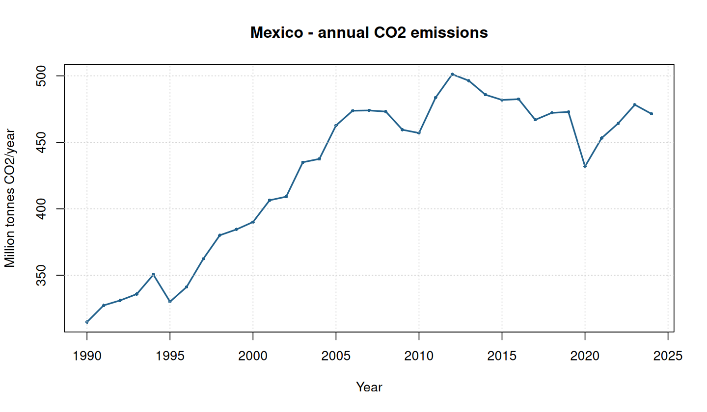

# CO₂ Emissions Analysis: Mexico (MEX)

**Student:** Mikylla Jamin

**GitHub Username:** jaminmikylla24-prog  

**Country:** Mexico  

**ISO-3 Code:** MEX  

**Study Period:** 1990–2024

## 1. Research Question

How have annual CO₂ emissions and CO₂ emissions per capita changed in Mexico from 1990 to 2024?

## 2. Data Source

This project uses data from Our World in Data (OWID), specifically the CO₂ and Greenhouse Gas Emissions dataset.

Dataset: https://github.com/owid/co2-data

The selected variables are:

- Year

- Annual CO₂ emissions

- CO₂ emissions per capita

Annual CO₂ emissions are measured in million tonnes per year, while per-capita emissions are measured in tonnes per person per year.

## 3. Software and Tools

The following tools were used:

- R

- RStudio

- Git

- GitHub

## 4. Methodology

The analysis was conducted using RStudio. The complete OWID dataset was downloaded and filtered to include only Mexico using its ISO-3 country code, MEX.

The selected data covered the period 1990–2024. The R script generated a country-specific CSV file, three graphs, summary statistics, and yearly percentage changes.

To reproduce the analysis, open the project in RStudio and run:

`source("scripts/analyze_co2.R")`

## 5. Project Files and Outputs

- `data/MEX_co2.csv` – Mexico's CO₂ emissions dataset.

- `scripts/analyze_co2.R` – R script used for the analysis.

- `figures/MEX_annual_co2.png` – Annual CO₂ emissions graph.

- `figures/MEX_per_capita.png` – CO₂ emissions per capita graph.

- `figures/MEX_annual_change.png` – Annual percentage change graph.

- `results/MEX_summary.csv` – Summary statistics.

- `results/MEX_yearly_changes.csv` – Yearly percentage changes.

- `results/session_info.txt` – R session information.

## 6. Graphical Results

### Annual CO₂ Emissions in Mexico

### CO₂ Emissions Per Capita

### Annual Percentage Change in CO₂ Emissions

## 7. Environmental Interpretation

This analysis examines changes in Mexico's annual CO₂ emissions and per-capita emissions from 1990 to 2024. Annual emissions represent the total amount of CO₂ released within the country, while per-capita emissions show the average emissions per person. These indicators help explain the difference between a country's total contribution and its emissions relative to population.

The graphs allow us to observe long-term patterns, including periods of increasing or decreasing emissions and unusual year-to-year changes. Changes in emissions may be associated with economic activity, industrial development, energy consumption, transportation, and environmental policies. However, the graphs alone cannot prove which factors caused these changes.

Mexico's emissions patterns are important because CO₂ contributes to global climate change. Changes in national emissions can affect climate-related risks and ecosystems, including biodiversity, habitats, and natural resources. Understanding these trends can help highlight the importance of cleaner energy, efficient transportation, and sustainable development.

This analysis has limitations because it uses territorial CO₂ emissions data and does not include all greenhouse gases or emissions from land-use change. Country-level statistics also cannot fully represent local environmental conditions. Actual numerical values and the peak emissions year should be interpreted using the summary CSV and graphs.

## 8. Limitations

The dataset focuses on territorial CO₂ emissions from fossil fuels and industrial processes. It does not represent all greenhouse gases or include land-use change emissions. Missing values were not treated as zero. National-level data may also hide differences between regions and industries within Mexico. Observed patterns do not establish causation.

## 9. References

- Our World in Data. CO₂ and Greenhouse Gas Emissions Dataset. https://github.com/owid/co2-data

- Our World in Data. CO₂ emissions data and methodology. https://ourworldindata.org/co2-emissions 
